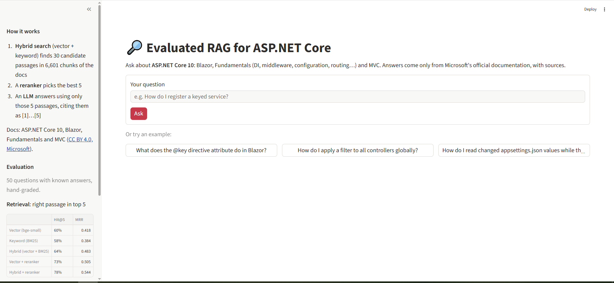

# 🔎 Evaluated RAG for ASP.NET Core

A question-answering chatbot over Microsoft's official **ASP.NET Core 10** documentation (Blazor, Fundamentals and MVC) that answers **only from the docs, with numbered sources**, plus an **evaluation suite that measures how well it actually works**.

**🔗 Live demo:** _add your Streamlit link here after deployment_



> "It works" is a claim. An eval table is proof.

---

## Results at a glance

| | Result |
|---|---|
| Right passage retrieved in the top 5 (Hit@5) | **60% → 78%** after adding hybrid search and a reranker |
| Answer score, hand-graded (50 questions) | **94%** |
| Hallucinated answers | **4%** (2 of 50) |
| Out-of-scope questions correctly refused | **5 / 5** |
| Answers correct **when retrieval found the right passage** | **100%** (35 / 35), with both a 3B and a 20B model |

**Key finding:** every wrong answer and every hallucination came from a **retrieval miss**. A model 7× larger gave the same correctness. **Retrieval, not the LLM, is the bottleneck**, so that's where future improvements belong.

---

## How it works

```
Question
   │
   ├─► Vector search (bge-small embeddings, ChromaDB) ─┐
   │                                                   ├─► Reciprocal Rank Fusion → 30 candidates
   └─► Keyword search (BM25) ──────────────────────────┘
                                                            │
                         Cross-encoder reranker (MiniLM) ◄──┘  → best 5 passages
                                                            │
                LLM answers using ONLY those 5, citing [1]–[5], or says
                "I couldn't find this in the documentation."
```

| Component | Choice |
|---|---|
| Documents | [dotnet/AspNetCore.Docs](https://github.com/dotnet/AspNetCore.Docs): `aspnetcore/blazor`, `fundamentals`, `mvc` (CC BY 4.0) |
| Chunking | Split by `#`/`##`/`###` headings, then max 1,000 characters with 150 overlap; each chunk carries an `Article > Section` header |
| Embeddings | `BAAI/bge-small-en-v1.5` (384 dimensions), stored in ChromaDB |
| Keyword search | BM25 (`rank-bm25`) |
| Reranker | `cross-encoder/ms-marco-MiniLM-L-6-v2`, re-scores the top 30 |
| LLM (live app) | `openai/gpt-oss-20b` via Groq |
| LLM (local) | `llama3.2:3b` via Ollama |
| App | Streamlit |

The whole pipeline lives in [`rag.py`](rag.py) and is used by **both** the evaluation notebook and the app, so the evaluation describes exactly what the app does.

---

## The data, and what made it messy

The docs are written for Microsoft's publishing system, not for plain reading. Cleaning them was a large part of the work ([`notebooks/02_clean.ipynb`](notebooks/02_clean.ipynb)):

- **Version blocks:** about half the pages repeat content per ASP.NET Core version (3.0 to 11.0) inside `:::moniker range="..."` blocks. I wrote a version filter that keeps only the text valid for **ASP.NET Core 10**, and skipped 10 pages that only apply to older versions.
- **Includes:** 699 `[!INCLUDE]` references. **141** were inserted (files available in the downloaded folders); **412** were dropped (mostly banners from a shared folder outside the download).
- **Code samples stored elsewhere:** **1,265** `:::code` / `[!code-…]` pointers to a separate samples repo, replaced with readable markers like `[Code sample: Program.cs]`.
- **Markup noise:** `<xref:…>` API references shortened to type names, links reduced to their text, callouts turned into "Note:" / "Warning:", HTML comments removed.
- **Not articles:** 160 include fragments and sample READMEs skipped.

| | Raw | Clean |
|---|---|---|
| Files / articles | 495 | **324** (Blazor 152, Fundamentals 128, MVC 44) |
| Characters | 6.75 M | 4.44 M (**34% removed**) |
| Chunks | 6,886 | **6,601** after removing 285 duplicates (4.1%) created by shared includes |

---

## Evaluation

### The eval set

[`evals/eval_set.jsonl`](evals/eval_set.jsonl): **50 questions**, each with an expected answer, its source article and an **evidence phrase** copied from the docs.

- 15 Blazor, 15 Fundamentals, 15 MVC, plus 5 **out-of-scope** questions (Django, Spring Boot, React, Rails, Flutter)
- 30 **direct** questions (use the docs' wording) and 15 **paraphrased** questions (describe the behaviour without the keyword, e.g. *"How do I register a service so a new instance is created per HTTP request?"*)
- Every evidence phrase is automatically checked to exist inside a chunk of its expected article, so no question is unanswerable by construction.
- Drafted with AI assistance from the source docs, automatically validated, and reviewed by me.

A retrieved chunk counts as correct only if it comes from the **expected article and contains the evidence phrase**.

### Retrieval: five setups compared

([`notebooks/07_retrieval_eval.ipynb`](notebooks/07_retrieval_eval.ipynb), 45 in-scope questions)

| Setup | Hit@1 | Hit@3 | **Hit@5** | **MRR** | Doc Hit@5 | Seconds / query |
|---|---|---|---|---|---|---|
| Vector (bge-small) | 29% | 44% | 60% | 0.418 | 93% | 0.05 |
| Keyword (BM25) | 24% | 47% | 58% | 0.384 | 87% | 0.04 |
| Hybrid (vector + BM25) | 36% | 58% | 64% | 0.483 | 87% | 0.11 |
| Vector + reranker | 38% | 53% | 73% | 0.505 | 91% | 4.46 |
| **Hybrid + reranker** ✅ | **40%** | **60%** | **78%** | **0.544** | 93% | 4.51 |

- **Hit@k:** the correct passage is in the top k. **MRR:** rewards ranking it high (1st = 1, 2nd = ½ …). **Doc Hit@5:** the right *article* is in the top 5.
- The gap between **Doc Hit@5 (93%)** and **Hit@5 (60%)** for plain vector search showed the problem: the right article, but the wrong paragraph. The reranker fixes most of that; keyword search rescues exact-term questions.
- Paraphrased questions improved the most: **47% → 73%** Hit@5.

### End-to-end answers: two LLMs, hand-graded

([`notebooks/08_rag_eval.ipynb`](notebooks/08_rag_eval.ipynb), all 50 questions, same retrieval)

Each answer was graded against the expected answer with a fixed rubric: **correct** (yes / partial / no) and **hallucinated** (states something false or invented). The graded sheets are in [`evals/`](evals/).

| | Llama 3.2 3B (local, Ollama) | gpt-oss-20b (Groq) ✅ live |
|---|---|---|
| **Score** (partial = ½) | 94% | **94%** |
| Correct / partial / wrong | 92% / 4% / 4% | 92% / 4% / 4% |
| **Hallucinated** | 4% | **4%** |
| Correct when retrieval **hit** (35) | 100% | **100%** |
| Correct when retrieval **missed** (10) | 60% | 60% |
| Refused when retrieval missed | 0 / 10 | 1 / 10 |
| Out-of-scope refused | 5 / 5 | 5 / 5 |
| Answers with citations | 71% | 75% |
| Average time per question | 76 s (laptop CPU) | **8 s** |

---

## What I learned

1. **Retrieval is the bottleneck.** Both LLMs answered all 35 well-retrieved questions correctly; all errors came from the 10 misses. Upgrading the LLM didn't change correctness; upgrading retrieval (60% → 78% Hit@5) is what moved the system.
2. **When retrieval misses, small models don't refuse; they improvise.** For *"new instance per HTTP request"*, the 3B model answered `AddTransient` (wrong; the answer is `AddScoped`), and in a later run invented a non-existent `AddHttpLogging(..., lifetime: Transient)` API, citing a source that doesn't say that.
3. **A RAG system can only know what's in its documents.** The ASP.NET Core DI article *links* to the .NET runtime docs for the full Transient/Scoped/Singleton definitions, so they aren't in this corpus. Only one sentence about `AddScoped` exists to find.
4. **Measuring at two levels pinpoints the cause.** Measuring Doc Hit@5 alongside Hit@5 pinpointed *why* retrieval failed (wrong paragraph, not wrong article), which pointed directly at the reranker as the fix.
5. **Debugging local inference:** on this laptop, Ollama's partial offload to the integrated GPU produced pure gibberish. Comparing CPU-only and mixed runs isolated the cause; the fix is a per-machine setting (`RAG_FORCE_CPU=1`), not a code change. Greedy decoding (temperature 0) also caused repetition loops in the 3B model, fixed with a fixed seed, slight temperature and a repeat penalty.

---

## Limitations and known issues

- **Small eval set:** 45 in-scope questions means each question is worth about 2 percentage points; differences of a few points are within noise.
- **Self-graded:** answers were graded by me. An independent grader or an LLM judge as a second opinion would strengthen the results.
- **Still missed by every retrieval setup:** questions F02, F14, B04, B13 and M15 (see the per-question reports in [`reports/`](reports/)).
- **Code samples aren't included:** they live in a separate repo, so answers that need full sample code are weaker.
- **Link cleanup:** 291 links whose text contains brackets (e.g. `` [`[JSImport]` attribute](xref:…) ``) slipped through cleaning in 78 docs. Minor noise; to be fixed together with the next re-embedding.
- **Free-tier limits:** the live app uses Groq's free tier (8,000 tokens/min, 200,000 tokens/day for `gpt-oss-20b`), so it limits questions per session and caches repeated questions.

---

## Cost

**₹0.** Free, openly licensed docs and models; embedding and reranking run on a laptop CPU; the hosted LLM uses Groq's free tier; the app runs on Streamlit Community Cloud's free tier.

---

## Project structure

```
aspnetcore-rag-eval/
├── app.py                      # Streamlit web app
├── rag.py                      # The pipeline: hybrid search + reranker + LLM (used by app AND eval)
├── requirements.txt
├── data/
│   ├── processed/
│   │   ├── docs_clean.jsonl    # 324 cleaned articles
│   │   └── chunks.jsonl        # 6,601 chunks
│   └── chroma/                 # vector database
├── evals/
│   ├── eval_set.jsonl          # 50 questions with expected answers and evidence
│   └── grading__*.xlsx         # hand-graded answers for each LLM
├── notebooks/
│   ├── 01_explore.ipynb        # inspect the raw docs, find the mess
│   ├── 02_clean.ipynb          # version filter, includes, markup cleanup
│   ├── 03_chunk.ipynb          # heading-aware chunking, de-duplication
│   ├── 04_embed.ipynb          # embeddings + ChromaDB
│   ├── 05_generate.ipynb       # first RAG answers with a local LLM
│   ├── 06_eval_set.ipynb       # load and validate the eval set
│   ├── 07_retrieval_eval.ipynb # Hit@k / MRR for five retrieval setups
│   └── 08_rag_eval.ipynb       # end-to-end runs, grading export, results
└── reports/                    # all evaluation results (CSV / JSONL)
```

---

## Run it locally

```bash
git clone https://github.com/YOUR-USERNAME/aspnetcore-rag-eval.git
cd aspnetcore-rag-eval
py -3.12 -m venv .venv
.venv\Scripts\activate                       # Windows
python -m pip install -r requirements.txt
```

**With the hosted LLM (fast):** create a free key at [console.groq.com](https://console.groq.com), then:

```bash
setx GROQ_API_KEY "your-key"                 # once; then reopen the terminal
$env:RAG_LLM_PROVIDER = "groq"
streamlit run app.py
```

**With a local LLM (free, offline):** install [Ollama](https://ollama.com), run `ollama pull llama3.2:3b`, then `streamlit run app.py`.

| Environment variable | Purpose |
|---|---|
| `RAG_LLM_PROVIDER` | `ollama` (default) or `groq` |
| `RAG_LLM` | Override the model name |
| `GROQ_API_KEY` | Groq API key (never commit it) |
| `RAG_FORCE_CPU` | Set to `1` if Ollama produces garbage output on your GPU |

**To rebuild the data from scratch:** download the docs with a sparse checkout of `aspnetcore/blazor`, `aspnetcore/fundamentals` and `aspnetcore/mvc` from [dotnet/AspNetCore.Docs](https://github.com/dotnet/AspNetCore.Docs), copy the `.md` files into `data/raw/`, and run notebooks 01–04 in order.

---

## Next steps

- Fix the remaining retrieval misses: try a stronger embedding model and query rewriting
- Add an LLM judge and report its agreement with the human grades
- Include the code samples from the separate samples repo
- Add a prompt-injection guard (e.g. Llama Prompt Guard 2) in front of the public app

---

## Credits

Documentation © Microsoft, from [dotnet/AspNetCore.Docs](https://github.com/dotnet/AspNetCore.Docs), licensed [CC BY 4.0](https://creativecommons.org/licenses/by/4.0/); text was cleaned and split into chunks for this project. Models: [BAAI/bge-small-en-v1.5](https://huggingface.co/BAAI/bge-small-en-v1.5), [cross-encoder/ms-marco-MiniLM-L-6-v2](https://huggingface.co/cross-encoder/ms-marco-MiniLM-L-6-v2), Llama 3.2 (Meta), gpt-oss-20b (OpenAI) via Groq.
